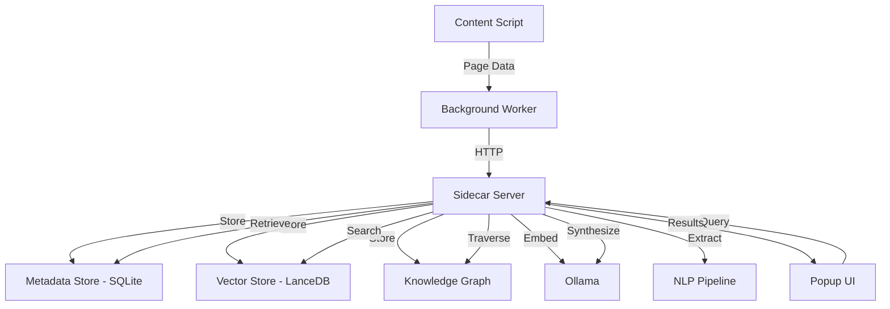

# Design Document: Human-Like Memory Engine

## Overview

The Human-Like Memory Engine transforms WebMind from a basic semantic search tool into a computational memory system that models human cognitive processes. The system implements eight core capabilities: associative memory through knowledge graphs, engagement-based prioritization, temporal decay with reinforcement, contextual memory via session detection, multi-modal embeddings for visual content, LLM-powered memory reconstruction, priority weighting through multiple signals, and autonomous clustering for thematic organization.

### Design Philosophy

Human memory is not a perfect recording device—it prioritizes, forgets, connects, and reconstructs. This design embraces those characteristics:

- **Associative**: Memories activate related memories through concept relationships
- **Selective**: Engagement signals determine what deserves remembering
- **Temporal**: Recent and frequently accessed memories stay strong; unused ones fade
- **Contextual**: Browsing sessions and tab groups provide organizational structure
- **Multi-modal**: Visual and textual content are equally searchable
- **Reconstructive**: Answers are synthesized from memory fragments, not retrieved verbatim
- **Adaptive**: Manual signals (bookmarks, pins) override automatic prioritization

### Key Architectural Decisions

1. **Hybrid Storage**: SQLite for structured metadata, LanceDB for vector embeddings, and a graph database (Neo4j or in-memory graph) for concept relationships
2. **Local-First**: All processing happens on-device using Ollama for embeddings and LLM inference
3. **Incremental Processing**: Content is processed asynchronously to avoid blocking page loads
4. **Dual Retrieval**: Semantic search via embeddings + graph traversal for associative recall
5. **Weighted Scoring**: Memory strength combines engagement (0.4), recency via decay, associations, and manual signals

## Architecture

### System Components



### Component Responsibilities

**Content Script** (`contents/webmind.ts`):
- Captures page metadata (title, URL, content)
- Tracks engagement signals (dwell time, scroll depth, revisits)
- Detects tab group context
- Extracts image and video URLs
- Sends data to background worker

**Background Worker** (`background.ts`):
- Receives messages from content scripts
- Forwards data to sidecar server
- Manages extension lifecycle

**Sidecar Server** (`sidecar/server.js`):
- Ingests page data and generates embeddings
- Manages three storage layers (SQLite, LanceDB, Knowledge Graph)
- Performs concept extraction and entity recognition
- Calculates engagement scores and memory strength
- Executes hybrid retrieval (semantic + associative)
- Orchestrates LLM-powered memory reconstruction
- Handles clustering and automatic linking

**Metadata Store** (SQLite):
- Stores structured page data
- Tracks engagement metrics
- Maintains session information
- Stores configuration

**Vector Store** (LanceDB):
- Stores text embeddings (nomic-embed-text, 768 dimensions)
- Stores image embeddings (CLIP ViT-B/32, 512 dimensions)
- Stores video thumbnail embeddings
- Supports approximate nearest neighbor search

**Knowledge Graph**:
- Stores concepts and entities
- Maintains bidirectional associations
- Tracks association strengths
- Supports graph traversal queries
- Links concepts to memory entries

### Data Flow

**Ingestion Pipeline**:
1. Content script captures page data + engagement signals
2. Background worker forwards to sidecar
3. Sidecar stores metadata in SQLite
4. Sidecar generates text embedding via Ollama
5. Sidecar extracts concepts via NLP pipeline
6. Sidecar stores concepts in knowledge graph
7. Sidecar creates associations between concepts
8. Sidecar processes images/videos if present
9. Sidecar assigns page to current browsing session

**Query Pipeline**:
1. User submits query via popup UI
2. Sidecar generates query embedding
3. Sidecar performs vector search in LanceDB
4. Sidecar identifies concepts in top results
5. Sidecar traverses knowledge graph (2 hops)
6. Sidecar retrieves associated memories
7. Sidecar calculates memory strength for all candidates
8. Sidecar applies decay function
9. Sidecar ranks by combined score
10. Sidecar sends top memories + context to Ollama
11. Sidecar returns synthesized answer + citations

## Components and Interfaces

### Content Script Interface

```typescript
interface PageData {
  title: string;
  url: string;
  content: string;
  timestamp: string;
  engagement: EngagementMetrics;
  context: BrowsingContext;
  media: MediaContent;
}

interface EngagementMetrics {
  dwellTime: number; // milliseconds
  scrollDepth: number; // percentage (0-100)
  revisitCount: number;
  isBookmarked: boolean;
}

interface BrowsingContext {
  sessionId: string;
  tabGroupId: string | null;
  sequenceNumber: number;
  previousUrl: string | null;
}

interface MediaContent {
  images: ImageData[];
  videos: VideoData[];
}

interface ImageData {
  url: string;
  width: number;
  height: number;
  alt: string;
}

interface VideoData {
  url: string;
  duration: number;
  thumbnailUrl: string;
}
```

### Sidecar Server API

```typescript
// POST /ingest
interface IngestRequest {
  pageData: PageData;
}

interface IngestResponse {
  success: boolean;
  memoryId: string;
  conceptsExtracted: number;
  associationsCreated: number;
}

// POST /search
interface SearchRequest {
  query: string;
  options?: SearchOptions;
}

interface SearchOptions {
  includeDecayed?: boolean;
  maxResults?: number;
  sessionFilter?: string;
  tabGroupFilter?: string;
  timeRange?: TimeRange;
}

interface TimeRange {
  start: string; // ISO timestamp
  end: string;
}

interface SearchResponse {
  synthesizedAnswer: string;
  citations: Citation[];
  rawResults: MemoryResult[];
  associationPaths: AssociationPath[];
}

interface Citation {
  memoryId: string;
  title: string;
  url: string;
  relevanceScore: number;
  excerpt: string;
}

interface MemoryResult {
  memoryId: string;
  title: string;
  url: string;
  content: string;
  timestamp: string;
  memoryStrength: number;
  engagementScore: number;
  decayedStrength: number;
  matchedConcepts: string[];
  isPinned: boolean;
  isBookmarked: boolean;
}

interface AssociationPath {
  fromMemory: string;
  toMemory: string;
  path: string[]; // concept names
  strength: number;
}

// POST /cluster
interface ClusterRequest {
  force?: boolean; // Force reclustering
}

interface ClusterResponse {
  clustersCreated: number;
  memoriesClustered: number;
}

// GET /config
interface ConfigResponse {
  decayRate: number;
  engagementWeights: EngagementWeights;
  sessionTimeout: number;
  minClusterSize: number;
}

interface EngagementWeights {
  dwellTime: number;
  scrollDepth: number;
  revisitCount: number;
}

// PUT /config
interface ConfigUpdateRequest {
  decayRate?: number;
  engagementWeights?: Partial<EngagementWeights>;
  sessionTimeout?: number;
  minClusterSize?: number;
}
```

### Knowledge Graph Schema

```typescript
// Node Types
interface ConceptNode {
  id: string;
  name: string;
  type: 'entity' | 'topic';
  confidence: number;
  firstSeen: string;
  lastSeen: string;
  occurrenceCount: number;
}

interface MemoryNode {
  id: string;
  memoryId: string; // References SQLite record
  timestamp: string;
}

interface ClusterNode {
  id: string;
  label: string;
  size: number;
  centroid: number[]; // Embedding vector
  createdAt: string;
}

// Edge Types
interface ConceptAssociation {
  from: string; // Concept ID
  to: string; // Concept ID
  strength: number; // 0.0 to 1.0
  coOccurrences: number;
  lastReinforced: string;
}

interface MemoryConceptLink {
  memoryId: string;
  conceptId: string;
  relevance: number;
}

interface ClusterMembership {
  memoryId: string;
  clusterId: string;
  distance: number; // Distance from centroid
}

interface CrossClusterLink {
  fromCluster: string;
  toCluster: string;
  similarity: number;
}
```

### Storage Schemas

**SQLite Schema**:

```sql
-- Memory entries
CREATE TABLE memories (
  id INTEGER PRIMARY KEY AUTOINCREMENT,
  title TEXT NOT NULL,
  url TEXT NOT NULL,
  content TEXT,
  timestamp TEXT NOT NULL,
  
  -- Engagement metrics
  dwell_time INTEGER DEFAULT 0,
  scroll_depth REAL DEFAULT 0,
  revisit_count INTEGER DEFAULT 0,
  last_accessed TEXT,
  
  -- Context
  session_id TEXT,
  tab_group_id TEXT,
  sequence_number INTEGER,
  previous_url TEXT,
  
  -- Priority signals
  is_bookmarked BOOLEAN DEFAULT 0,
  is_pinned BOOLEAN DEFAULT 0,
  
  -- Calculated scores
  engagement_score REAL DEFAULT 0,
  memory_strength REAL DEFAULT 0,
  
  -- Metadata
  created_at TEXT DEFAULT CURRENT_TIMESTAMP,
  updated_at TEXT DEFAULT CURRENT_TIMESTAMP
);

CREATE INDEX idx_memories_url ON memories(url);
CREATE INDEX idx_memories_session ON memories(session_id);
CREATE INDEX idx_memories_timestamp ON memories(timestamp);

-- Browsing sessions
CREATE TABLE sessions (
  id TEXT PRIMARY KEY,
  start_time TEXT NOT NULL,
  end_time TEXT,
  page_count INTEGER DEFAULT 0,
  dominant_concepts TEXT, -- JSON array
  label TEXT
);

-- Media content
CREATE TABLE images (
  id INTEGER PRIMARY KEY AUTOINCREMENT,
  memory_id INTEGER NOT NULL,
  url TEXT NOT NULL,
  width INTEGER,
  height INTEGER,
  alt TEXT,
  FOREIGN KEY (memory_id) REFERENCES memories(id) ON DELETE CASCADE
);

CREATE TABLE videos (
  id INTEGER PRIMARY KEY AUTOINCREMENT,
  memory_id INTEGER NOT NULL,
  url TEXT NOT NULL,
  duration INTEGER,
  thumbnail_url TEXT,
  FOREIGN KEY (memory_id) REFERENCES memories(id) ON DELETE CASCADE
);

-- Configuration
CREATE TABLE config (
  key TEXT PRIMARY KEY,
  value TEXT NOT NULL,
  updated_at TEXT DEFAULT CURRENT_TIMESTAMP
);

-- Insert default configuration
INSERT INTO config (key, value) VALUES
  ('decay_rate', '0.02'),
  ('engagement_weight_dwell', '0.4'),
  ('engagement_weight_scroll', '0.3'),
  ('engagement_weight_revisit', '0.3'),
  ('session_timeout', '1800'), -- 30 minutes in seconds
  ('min_cluster_size', '3');
```

**LanceDB Schema**:

```typescript
// Text embeddings table
interface TextEmbedding {
  memory_id: number;
  vector: number[]; // 768 dimensions (nomic-embed-text)
  text: string;
  title: string;
  url: string;
  timestamp: string;
}

// Image embeddings table
interface ImageEmbedding {
  image_id: number;
  memory_id: number;
  vector: number[]; // 512 dimensions (CLIP ViT-B/32)
  image_url: string;
  alt_text: string;
}

// Video embeddings table
interface VideoEmbedding {
  video_id: number;
  memory_id: number;
  vector: number[]; // 512 dimensions (CLIP ViT-B/32)
  video_url: string;
  thumbnail_url: string;
}
```

## Data Models

### Core Domain Models

**Memory Entry**:
- Represents a single webpage visit
- Contains content, metadata, and engagement metrics
- Has calculated memory strength score
- Links to concepts in knowledge graph
- Belongs to a browsing session

**Concept**:
- Named entity or topic extracted from content
- Has confidence score and occurrence count
- Connected to other concepts via associations
- Links to memory entries where it appears

**Association**:
- Bidirectional relationship between concepts
- Has strength score based on co-occurrence
- Reinforced each time concepts appear together
- Used for graph traversal during retrieval

**Browsing Session**:
- Temporal grouping of related page visits
- Detected via time gaps and content similarity
- Has dominant concepts and generated label
- Maintains sequential order of pages

**Memory Cluster**:
- Automatic grouping of similar memories
- Has centroid embedding and descriptive label
- Created via HDBSCAN clustering
- Connected to other clusters via similarity

### Calculated Values

**Engagement Score**:
```
engagement_score = 
  (normalize(dwell_time) * 0.4) +
  (scroll_depth / 100 * 0.3) +
  (log(1 + revisit_count) * 0.3)

where normalize(dwell_time) = min(dwell_time / 300, 1.0)
```

**Memory Strength** (before decay):
```
base_strength = engagement_score * 0.4 + association_boost

bookmark_multiplier = is_bookmarked ? 2.0 : 1.0
revisit_boost = min(log(1 + unique_visit_dates) * 0.1, 1.0)

memory_strength = (base_strength + revisit_boost) * bookmark_multiplier
```

**Decay Function**:
```
decay_resistance = 1 + (0.1 * revisit_count)
effective_decay_rate = min(decay_rate / decay_resistance, 0.005)

if is_pinned:
  effective_decay_rate = 0

days_since_access = (now - last_accessed) / (24 * 60 * 60 * 1000)
decayed_strength = memory_strength * exp(-effective_decay_rate * days_since_access)
```

**Association Strength**:
```
co_occurrence_score = log(1 + co_occurrences) / log(1 + max_co_occurrences)
recency_factor = exp(-0.01 * days_since_reinforcement)

association_strength = co_occurrence_score * recency_factor
```

### NLP Pipeline

**Concept Extraction**:
1. Tokenize content into sentences
2. Extract named entities using pattern matching or lightweight NER
3. Extract key topics using TF-IDF
4. Normalize concept names (lowercase, lemmatization)
5. Filter stopwords and common terms
6. Assign confidence scores
7. Keep only concepts with confidence > 0.6

**Entity Types**:
- PERSON: Names of people
- ORG: Organizations, companies
- TECH: Technologies, programming languages, frameworks
- TOPIC: General subjects and themes

**Normalization Rules**:
- "JavaScript" → "javascript"
- "React.js" → "react"
- "machine learning" → "machine_learning"
- "AWS Lambda" → "aws_lambda"

## Testing Strategy

### Unit Testing

**Engagement Score Calculation**:
- Test normalization of dwell time values
- Test scroll depth percentage conversion
- Test logarithmic scaling of revisit counts
- Test weighted combination of metrics
- Test edge cases (zero values, extreme values)

**Memory Decay**:
- Test exponential decay formula
- Test decay resistance calculation
- Test pinned memory (zero decay)
- Test decay rate capping
- Test time delta calculations

**Concept Extraction**:
- Test entity recognition with sample texts
- Test stopword filtering
- Test concept normalization
- Test confidence scoring
- Test minimum confidence threshold

**Association Strength**:
- Test co-occurrence counting
- Test strength calculation formula
- Test recency factor decay
- Test strength updates on reinforcement

**Session Detection**:
- Test timeout-based session boundaries
- Test embedding similarity threshold
- Test session metadata generation
- Test sequential numbering

**Multi-Modal Scoring**:
- Test weighted combination of text and image embeddings
- Test score normalization
- Test fallback when modalities are missing

### Integration Testing

**Ingestion Pipeline**:
- Test end-to-end page data ingestion
- Test embedding generation via Ollama
- Test concept extraction and storage
- Test association creation
- Test session assignment
- Test image/video processing

**Query Pipeline**:
- Test semantic search via LanceDB
- Test graph traversal for associations
- Test memory strength calculation
- Test decay application
- Test result ranking
- Test LLM synthesis
- Test citation generation

**Storage Layer**:
- Test SQLite CRUD operations
- Test LanceDB vector operations
- Test knowledge graph queries
- Test transaction handling
- Test data consistency across stores

**Clustering**:
- Test HDBSCAN clustering execution
- Test cluster label generation
- Test cross-cluster association detection
- Test incremental clustering triggers

### Performance Testing

**Query Latency**:
- Measure end-to-end query time
- Target: 95th percentile < 500ms
- Test with 1K, 10K, 100K memory entries
- Profile bottlenecks (embedding, search, graph traversal)

**Ingestion Throughput**:
- Measure pages processed per second
- Test concurrent ingestion
- Test embedding generation rate
- Test concept extraction speed

**Storage Scalability**:
- Test with 100K memory entries
- Measure query performance degradation
- Test index effectiveness
- Measure storage size growth

**Memory Usage**:
- Monitor sidecar server memory consumption
- Test with large result sets
- Test graph traversal memory usage
- Test embedding cache size

### Migration Testing

**Data Migration**:
- Test detection of existing WebMind data
- Test schema migration from old to new
- Test preservation of timestamps
- Test generation of default engagement metrics
- Test concept extraction from historical content
- Measure migration time for 10K records

### Configuration Testing

**Config Validation**:
- Test valid configuration updates
- Test invalid value rejection
- Test configuration persistence
- Test runtime application without restart

## Error Handling

### Content Script Errors

**Page Access Failures**:
- Handle pages with restricted content access
- Skip pages with CSP violations
- Log errors without blocking page load

**Engagement Tracking Failures**:
- Handle timer failures gracefully
- Use default values if tracking fails
- Continue ingestion with partial data

### Sidecar Server Errors

**Ollama Connection Failures**:
- Detect when Ollama is unavailable
- Fall back to search-only mode (no synthesis)
- Queue embedding generation for retry
- Display clear error message to user

**Storage Failures**:
- Handle SQLite write failures
- Handle LanceDB index corruption
- Implement transaction rollback
- Log errors for debugging

**Concept Extraction Failures**:
- Continue ingestion if NLP fails
- Store page without concepts
- Retry extraction in background

**Graph Traversal Failures**:
- Fall back to semantic search only
- Handle cycles in graph traversal
- Implement traversal depth limits
- Handle missing nodes gracefully

### Query Errors

**Empty Results**:
- Return helpful message when no memories match
- Suggest query refinements
- Offer to search without filters

**LLM Synthesis Failures**:
- Return raw search results if synthesis fails
- Display error message
- Allow retry

**Timeout Handling**:
- Implement query timeout (5 seconds)
- Return partial results if timeout occurs
- Log slow queries for optimization

### Data Consistency

**Cross-Store Consistency**:
- Use transaction-like patterns across stores
- Implement cleanup for orphaned records
- Periodic consistency checks
- Repair tools for inconsistencies

**Embedding Version Mismatches**:
- Detect model version changes
- Flag affected embeddings
- Provide re-embedding tools
- Maintain backward compatibility

## Migration Strategy

### Phase 1: Schema Migration

1. Detect existing `webmind.db` SQLite database
2. Create new tables with extended schema
3. Copy existing `pages` table data to `memories` table
4. Generate default engagement metrics:
   - `dwell_time`: 60000 (1 minute default)
   - `scroll_depth`: 50.0 (assume partial read)
   - `revisit_count`: 0
   - `engagement_score`: calculated from defaults
5. Create session records for historical pages (group by date)
6. Preserve original timestamps

### Phase 2: Embedding Migration

1. Detect existing LanceDB `webmind_vectors` table
2. Verify embedding dimensions (should be 768 for nomic-embed-text)
3. If dimensions match, keep existing embeddings
4. If dimensions differ, schedule re-embedding
5. Add `memory_id` foreign key references

### Phase 3: Concept Extraction

1. Process historical memories in batches (100 at a time)
2. Extract concepts from stored content
3. Build knowledge graph from historical data
4. Create associations based on co-occurrence
5. Display migration progress in UI

### Phase 4: Validation

1. Verify record counts match across stores
2. Test queries against migrated data
3. Validate embedding search results
4. Check graph connectivity

### Rollback Plan

- Keep backup of original database
- Provide rollback script
- Document manual recovery steps

## Configuration Management

### Configuration File

Location: `sidecar/config.json`

```json
{
  "decay": {
    "baseRate": 0.02,
    "maxRate": 0.005,
    "resistanceFactor": 0.1
  },
  "engagement": {
    "weights": {
      "dwellTime": 0.4,
      "scrollDepth": 0.3,
      "revisitCount": 0.3
    },
    "dwellTimeNormalization": 300,
    "lowEngagementThreshold": {
      "dwellTime": 10,
      "scrollDepth": 25
    },
    "highEngagementThreshold": {
      "dwellTime": 120,
      "scrollDepth": 75
    }
  },
  "session": {
    "timeoutSeconds": 1800,
    "similarityThreshold": 0.7
  },
  "clustering": {
    "minClusterSize": 3,
    "triggerThreshold": 50,
    "algorithm": "hdbscan",
    "minSamples": 2
  },
  "retrieval": {
    "maxResults": 10,
    "graphTraversalDepth": 2,
    "associationThreshold": 0.3,
    "multiModalWeights": {
      "text": 0.6,
      "image": 0.4
    }
  },
  "models": {
    "textEmbedding": "nomic-embed-text",
    "imageEmbedding": "clip-vit-b-32",
    "synthesis": "llama3.2"
  },
  "performance": {
    "queryTimeout": 5000,
    "cacheSize": 1000,
    "batchSize": 100
  }
}
```

### Configuration Validation

```typescript
interface ConfigValidator {
  validateDecayRate(rate: number): boolean; // 0 < rate < 1
  validateWeight(weight: number): boolean; // 0 <= weight <= 1
  validateTimeout(seconds: number): boolean; // seconds > 0
  validateClusterSize(size: number): boolean; // size >= 2
}
```

### Runtime Configuration Updates

- Configuration changes apply immediately to new operations
- Existing memories retain their calculated scores
- Recalculation triggered only on next access
- Configuration history logged for debugging

## Privacy and Security

### Data Locality

- All data stored in user's local filesystem
- No external API calls except to local Ollama
- No telemetry or analytics
- No cloud synchronization

### Data Encryption

- SQLite database encrypted using SQLCipher extension
- Encryption key derived from system credentials
- LanceDB files protected by filesystem permissions
- Configuration file contains no sensitive data

### Data Export

- Export all memories as JSON
- Export knowledge graph as GraphML
- Export embeddings as numpy arrays
- Export configuration as JSON

### Data Deletion

- Provide UI to delete individual memories
- Provide bulk deletion by date range
- Cascade delete associated concepts and embeddings
- Secure deletion (overwrite files)

## Performance Optimization

### Caching Strategy

**Memory Cache**:
- Cache frequently accessed memory entries (LRU, 1000 entries)
- Cache engagement scores to avoid recalculation
- Cache session metadata

**Embedding Cache**:
- Cache query embeddings for repeated queries
- Cache concept embeddings for graph traversal

**Graph Cache**:
- Cache association paths for common concept pairs
- Cache cluster centroids

### Indexing Strategy

**SQLite Indexes**:
- Index on `url` for revisit detection
- Index on `session_id` for session queries
- Index on `timestamp` for temporal queries
- Composite index on `(memory_strength, timestamp)` for ranking

**LanceDB Indexes**:
- IVF (Inverted File) index for approximate nearest neighbor
- Configure number of partitions based on dataset size
- Tune nprobes parameter for accuracy/speed tradeoff

**Graph Indexes**:
- Index concept nodes by name
- Index associations by strength
- Index cluster memberships

### Batch Processing

**Ingestion**:
- Queue page data for batch processing
- Process embeddings in batches of 10
- Extract concepts in batches
- Update associations in batches

**Clustering**:
- Run clustering weekly or after 50 new memories
- Process in background thread
- Incremental clustering for new memories

### Query Optimization

**Early Termination**:
- Stop graph traversal if result set is sufficient
- Limit LLM context to top 10 memories
- Skip synthesis for simple queries

**Parallel Processing**:
- Generate query embeddings in parallel (text + image)
- Search multiple LanceDB tables concurrently
- Fetch memory metadata in parallel

## Deployment Considerations

### System Requirements

- Node.js 18+ for sidecar server
- Ollama installed and running
- 4GB RAM minimum (8GB recommended)
- 10GB disk space for 100K memories
- SQLCipher extension for SQLite

### Installation Steps

1. Install Ollama and pull required models:
   ```bash
   ollama pull nomic-embed-text
   ollama pull llama3.2
   ```

2. Install sidecar dependencies:
   ```bash
   cd sidecar
   npm install express cors sqlite3 @lancedb/lancedb ollama
   npm install sqlcipher
   ```

3. Initialize databases:
   ```bash
   node init-db.js
   ```

4. Start sidecar server:
   ```bash
   node server.js
   ```

5. Load Chrome extension in developer mode

### Monitoring

**Health Checks**:
- Sidecar server health endpoint
- Ollama connectivity check
- Database integrity check
- Storage usage monitoring

**Metrics**:
- Query latency (p50, p95, p99)
- Ingestion rate (pages/second)
- Memory count and growth rate
- Concept count and association count
- Storage size (SQLite, LanceDB, total)

**Logging**:
- Error logs for debugging
- Query logs for optimization
- Migration logs for troubleshooting
- Configuration change logs

## Future Enhancements

### Potential Improvements

1. **Collaborative Filtering**: Learn from usage patterns to improve ranking
2. **Temporal Queries**: "What was I reading about React last month?"
3. **Visual Search**: Upload image to find similar pages
4. **Audio Transcription**: Extract concepts from video/podcast content
5. **Cross-Device Sync**: Encrypted sync via user-controlled server
6. **Smart Notifications**: Surface relevant memories proactively
7. **Memory Consolidation**: Merge duplicate or highly similar memories
8. **Concept Hierarchies**: Build taxonomy of concepts
9. **Personalized Decay**: Learn individual forgetting curves
10. **Memory Journaling**: Daily/weekly summaries of browsing themes

### Scalability Improvements

1. **Distributed Storage**: Shard embeddings across multiple LanceDB instances
2. **Incremental Indexing**: Update indexes without full rebuild
3. **Lazy Loading**: Load memory content on-demand
4. **Archival Storage**: Move old low-strength memories to cold storage
5. **Compression**: Compress stored content and embeddings

### Research Directions

1. **Attention Mechanisms**: Track which parts of pages receive focus
2. **Emotional Valence**: Detect and track emotional response to content
3. **Causal Relationships**: Detect cause-effect in browsing patterns
4. **Predictive Retrieval**: Anticipate information needs
5. **Meta-Memory**: Track confidence in memory accuracy


## Correctness Properties

*A property is a characteristic or behavior that should hold true across all valid executions of a system—essentially, a formal statement about what the system should do. Properties serve as the bridge between human-readable specifications and machine-verifiable correctness guarantees.*

### Reflection on Properties

After analyzing all acceptance criteria, I identified the following areas of potential redundancy:

1. **Decay Calculations**: Properties 7, 8, and 9 all relate to decay computation. These can be combined into comprehensive decay properties.
2. **Score Calculations**: Properties 4, 5, and 6 all involve weighted score calculations. These share common patterns.
3. **Filtering Rules**: Properties 2.4, 2.6, and 8.5 are all threshold-based filtering. These can be generalized.
4. **Graph Operations**: Properties 1.3 and 1.5 both test graph structure integrity.

After reflection, the following properties provide unique validation value without redundancy:

### Property 1: Bidirectional Association Symmetry

*For any* two concepts with an association in the Knowledge_Graph, if concept A is associated with concept B, then concept B SHALL be associated with concept A with the same strength score.

**Validates: Requirements 1.3**

### Property 2: Graph Traversal Hop Limit

*For any* concept in the Knowledge_Graph, when retrieving associated concepts within N hops, all returned concepts SHALL have a shortest path distance of at most N hops from the source concept.

**Validates: Requirements 1.5**

### Property 3: Association Strength Calculation

*For any* two concepts with co-occurrence count C and maximum co-occurrence M, the association strength SHALL equal log(1 + C) / log(1 + M) multiplied by the recency factor.

**Validates: Requirements 1.6**

### Property 4: Association Threshold Filtering

*For any* concept pair in the Knowledge_Graph, a persistent relationship SHALL exist if and only if the association strength is greater than or equal to 0.3.

**Validates: Requirements 1.7**

### Property 5: Concept Normalization Idempotence

*For any* concept name, applying normalization twice SHALL produce the same result as applying it once (normalization is idempotent).

**Validates: Requirements 2.3**

### Property 6: Stopword Exclusion Completeness

*For any* list of extracted concepts after filtering, no concept name SHALL match any entry in the stopword list.

**Validates: Requirements 2.4**

### Property 7: Confidence Score Bounds

*For any* extracted concept, the confidence score SHALL be a value in the range [0.0, 1.0].

**Validates: Requirements 2.5**

### Property 8: Confidence Threshold Filtering

*For any* concept stored in the Knowledge_Graph, its confidence score SHALL be greater than 0.6.

**Validates: Requirements 2.6**

### Property 9: Engagement Score Composition

*For any* engagement metrics (dwell_time, scroll_depth, revisit_count), the calculated engagement score SHALL equal:
(normalize(dwell_time) × 0.4) + (scroll_depth / 100 × 0.3) + (log(1 + revisit_count) × 0.3)

where normalize(dwell_time) = min(dwell_time / 300, 1.0)

**Validates: Requirements 4.4**

### Property 10: Memory Strength Engagement Weight

*For any* engagement score E and memory strength S, if the memory has no other boosts, then S SHALL include E weighted by coefficient 0.4.

**Validates: Requirements 4.6**

### Property 11: Exponential Decay Formula

*For any* memory strength M and time delta T (in days), the decayed strength SHALL equal M × e^(-decay_rate × T), where decay_rate is the effective decay coefficient after applying resistance.

**Validates: Requirements 7.1, 7.2**

### Property 12: Decay Timer Reset

*For any* memory entry, after an access event, the days_since_access value SHALL be 0 when calculated immediately after the access.

**Validates: Requirements 7.3**

### Property 13: Decay Resistance Calculation

*For any* memory entry with revisit count R, the decay resistance SHALL equal 1 + (0.1 × R).

**Validates: Requirements 8.3**

### Property 14: Effective Decay Rate

*For any* base decay rate D and decay resistance R, the effective decay rate SHALL equal D / R.

**Validates: Requirements 8.4**

### Property 15: Decay Rate Capping

*For any* memory entry with revisit count greater than 10, the effective decay coefficient SHALL not exceed 0.005.

**Validates: Requirements 8.5**

### Property 16: Pinned Memory Zero Decay

*For any* memory entry marked as pinned, the effective decay rate SHALL be 0, and the decayed strength SHALL equal the original memory strength regardless of time elapsed.

**Validates: Requirements 19.2**

### Property 17: Session Continuity Threshold

*For any* two consecutive page visits with embedding similarity S, if S > 0.7, then both pages SHALL belong to the same browsing session.

**Validates: Requirements 9.4**

### Property 18: Multi-Modal Score Weighting

*For any* text similarity score T and image similarity score I, the combined multi-modal score SHALL equal (T × 0.6) + (I × 0.4).

**Validates: Requirements 14.2, 14.3**

### Property 19: Bookmark Strength Multiplier

*For any* memory entry with base memory strength S, if the entry is bookmarked, the final memory strength SHALL equal S × 2.0.

**Validates: Requirements 18.2**

### Property 20: Revisit Logarithmic Scaling

*For any* revisit count R, the revisit component of memory strength SHALL be calculated as log(1 + R).

**Validates: Requirements 20.2**

### Property 21: Revisit Boost Capping

*For any* calculated revisit boost value B, the final revisit boost applied to memory strength SHALL be min(B, 1.0).

**Validates: Requirements 20.5**

### Property 22: Dwell Time Normalization Bounds

*For any* dwell time value D (in seconds), the normalized dwell time SHALL be in the range [0.0, 1.0], calculated as min(D / 300, 1.0).

**Validates: Requirements 4.4 (normalization component)**

### Property 23: Scroll Depth Percentage Bounds

*For any* scroll depth value S, the value SHALL be in the range [0.0, 100.0], representing percentage of page height.

**Validates: Requirements 6.1, 6.2**

### Property 24: Memory Strength Non-Negativity

*For any* memory entry, the calculated memory strength (before or after decay) SHALL be a non-negative value.

**Validates: Requirements 4.4, 7.1 (implicit invariant)**

### Property 25: Association Strength Symmetry

*For any* two concepts A and B with a bidirectional association, the strength of the A→B association SHALL equal the strength of the B→A association.

**Validates: Requirements 1.3, 1.6 (combined)**


## Testing Strategy (Detailed)

### Implementation of Property-Based Testing

**Framework Selection**:
- **JavaScript/TypeScript**: Use `fast-check` library for property-based testing
- **Minimum Iterations**: 100 runs per property test (due to randomization)
- **Test Organization**: Group properties by domain (scoring, decay, graph, normalization)

**Property Test Structure**:

```typescript
import fc from 'fast-check';

// Example: Property 9 - Engagement Score Composition
describe('Engagement Score Calculation', () => {
  it('Property 9: Engagement score composition formula', () => {
    /**
     * Feature: human-like-memory-engine
     * Property 9: For any engagement metrics, the calculated engagement score
     * SHALL equal the weighted sum formula
     */
    fc.assert(
      fc.property(
        fc.integer({ min: 0, max: 3600 }), // dwell_time in seconds
        fc.float({ min: 0, max: 100 }), // scroll_depth percentage
        fc.integer({ min: 0, max: 100 }), // revisit_count
        (dwellTime, scrollDepth, revisitCount) => {
          const metrics = { dwellTime, scrollDepth, revisitCount };
          const score = calculateEngagementScore(metrics);
          
          const normalizedDwell = Math.min(dwellTime / 300, 1.0);
          const expected = 
            (normalizedDwell * 0.4) +
            (scrollDepth / 100 * 0.3) +
            (Math.log(1 + revisitCount) * 0.3);
          
          return Math.abs(score - expected) < 0.0001; // floating point tolerance
        }
      ),
      { numRuns: 100 }
    );
  });
});
```

**Generator Strategies**:

1. **Engagement Metrics Generator**:
   - Dwell time: 0 to 3600 seconds (1 hour)
   - Scroll depth: 0.0 to 100.0
   - Revisit count: 0 to 100
   - Include edge cases: zero values, maximum values

2. **Concept Name Generator**:
   - ASCII strings with various cases
   - Unicode characters
   - Special characters and punctuation
   - Empty strings (should be filtered)
   - Very long strings (>1000 chars)

3. **Graph Structure Generator**:
   - Random directed graphs with 10-100 nodes
   - Varying edge densities
   - Disconnected components
   - Cycles and self-loops

4. **Time Delta Generator**:
   - 0 to 365 days
   - Include fractional days
   - Edge case: exactly 0 (just accessed)

5. **Memory Strength Generator**:
   - 0.0 to 10.0 (reasonable range)
   - Include very small values (near zero)
   - Include negative values (should be rejected)

**Property Test Tags**:

Each property test MUST include a comment tag in this format:

```typescript
/**
 * Feature: human-like-memory-engine
 * Property {number}: {property statement}
 */
```

This enables traceability from test code back to design properties.

### Unit Testing Strategy

**Complementary Unit Tests**:

While property tests verify universal behaviors, unit tests cover:

1. **Specific Examples**:
   - Test engagement score with known input/output pairs
   - Test concept extraction with sample texts
   - Test session detection with specific page sequences

2. **Edge Cases**:
   - Zero dwell time (should not crash)
   - Empty content (should handle gracefully)
   - Maximum values (should not overflow)
   - Null/undefined inputs (should validate)

3. **Error Conditions**:
   - Invalid confidence scores (< 0 or > 1)
   - Negative time deltas
   - Malformed concept names
   - Graph cycles in traversal

4. **Integration Points**:
   - SQLite transaction handling
   - LanceDB connection failures
   - Ollama timeout handling
   - Knowledge graph query errors

**Unit Test Organization**:

```
tests/
├── unit/
│   ├── scoring/
│   │   ├── engagement-score.test.ts
│   │   ├── memory-strength.test.ts
│   │   └── decay-function.test.ts
│   ├── extraction/
│   │   ├── concept-extraction.test.ts
│   │   ├── entity-recognition.test.ts
│   │   └── normalization.test.ts
│   ├── graph/
│   │   ├── association-creation.test.ts
│   │   ├── traversal.test.ts
│   │   └── strength-calculation.test.ts
│   └── session/
│       ├── detection.test.ts
│       └── labeling.test.ts
├── property/
│   ├── scoring-properties.test.ts
│   ├── decay-properties.test.ts
│   ├── graph-properties.test.ts
│   └── normalization-properties.test.ts
└── integration/
    ├── ingestion-pipeline.test.ts
    ├── query-pipeline.test.ts
    ├── storage-layer.test.ts
    └── clustering.test.ts
```

### Integration Testing Strategy

**End-to-End Scenarios**:

1. **Ingestion Pipeline**:
   - Create mock page data
   - Send through content script → background → sidecar
   - Verify storage in all three stores (SQLite, LanceDB, Graph)
   - Verify concept extraction and association creation
   - Verify session assignment

2. **Query Pipeline**:
   - Ingest sample memories
   - Submit various query types
   - Verify semantic search results
   - Verify graph traversal expansion
   - Verify memory strength ranking
   - Verify LLM synthesis (with mocked Ollama)

3. **Storage Consistency**:
   - Verify foreign key relationships
   - Test cascade deletes
   - Test transaction rollback
   - Verify cross-store consistency

4. **Clustering Pipeline**:
   - Ingest diverse content
   - Trigger clustering
   - Verify cluster creation
   - Verify cluster labels
   - Verify cross-cluster associations

**Mock Strategy**:

- **Ollama**: Mock embedding generation and LLM synthesis for fast tests
- **File System**: Use in-memory SQLite for unit tests
- **Time**: Mock Date.now() for deterministic decay testing
- **Network**: Mock HTTP requests in content script tests

### Performance Testing Strategy

**Benchmarks**:

1. **Query Latency**:
   - Measure p50, p95, p99 latencies
   - Test with 1K, 10K, 100K memories
   - Target: 95th percentile < 500ms
   - Profile slow queries

2. **Ingestion Throughput**:
   - Measure pages/second
   - Test concurrent ingestion
   - Identify bottlenecks

3. **Memory Usage**:
   - Monitor sidecar process memory
   - Test with large result sets
   - Detect memory leaks

4. **Storage Growth**:
   - Measure database size over time
   - Test with 100K memories
   - Verify index effectiveness

**Load Testing**:

- Simulate realistic browsing patterns
- Test with multiple concurrent queries
- Stress test graph traversal
- Test clustering with large datasets

### Migration Testing Strategy

**Test Scenarios**:

1. **Schema Migration**:
   - Create old-format database
   - Run migration script
   - Verify all data preserved
   - Verify new columns populated

2. **Embedding Migration**:
   - Test with matching dimensions (keep)
   - Test with mismatched dimensions (re-embed)
   - Verify foreign key integrity

3. **Concept Extraction**:
   - Test batch processing
   - Verify progress tracking
   - Test interruption and resume

4. **Performance**:
   - Measure migration time for 10K records
   - Target: < 10 minutes
   - Test with 100K records

### Test Data Management

**Fixtures**:

- Sample page content (various domains)
- Pre-calculated embeddings
- Sample knowledge graphs
- Browsing session sequences

**Data Generators**:

- Random page data generator
- Concept name generator
- Graph structure generator
- Engagement metrics generator

### Continuous Integration

**CI Pipeline**:

1. Run unit tests (fast, < 1 minute)
2. Run property tests (moderate, < 5 minutes)
3. Run integration tests (slower, < 10 minutes)
4. Run performance benchmarks (on main branch only)
5. Generate coverage report (target: > 80%)

**Test Environments**:

- **Unit/Property**: In-memory databases, mocked Ollama
- **Integration**: Local SQLite/LanceDB, mocked Ollama
- **E2E**: Full stack with real Ollama (optional, manual)

### Test Coverage Goals

- **Unit Tests**: > 80% line coverage
- **Property Tests**: All 25 properties implemented
- **Integration Tests**: All major pipelines covered
- **Performance Tests**: All critical paths benchmarked

### Testing Anti-Patterns to Avoid

1. **Don't test external libraries**: Don't test that LanceDB works, test that we use it correctly
2. **Don't test Ollama**: Mock it for unit tests, use real instance only for E2E
3. **Don't over-specify**: Property tests should verify behavior, not implementation
4. **Don't ignore flaky tests**: Fix or remove them
5. **Don't skip edge cases**: Zero, null, empty, maximum values must be tested
