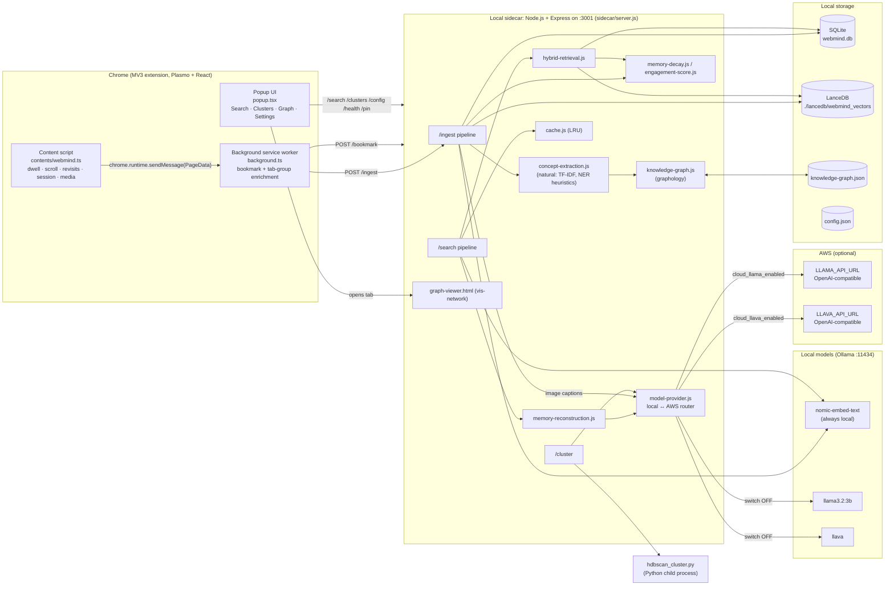
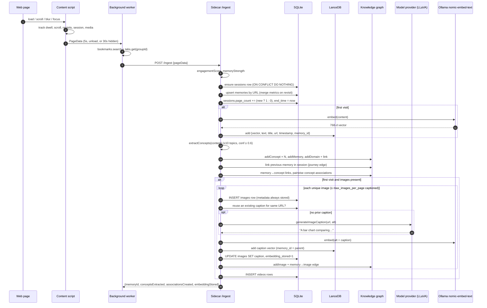
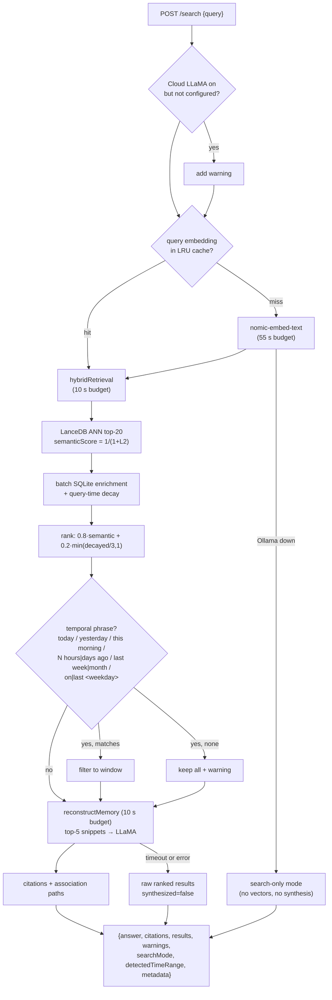

# WebMind: a human-like memory engine for your browser

WebMind is a Chrome (Manifest V3) extension with a local Node.js "sidecar" server. Together they turn your browsing into a personal memory you can search in plain language. It doesn't keep a flat list of URLs the way browser history does. Instead it models memory roughly the way people remember things:

- **Engagement shapes memory.** Pages you read carefully, scroll through, revisit or bookmark become *stronger* memories.
- **Memories fade.** Strength decays exponentially over time. Revisits slow the decay, and pinned memories never fade.
- **Memories are associative.** Concepts pulled from each page form a co-occurrence graph, alongside website hubs, browsing-session "journeys" and image nodes.
- **Memories are multimodal.** Images on a page are captioned by a vision model (LLaVA), and the captions are embedded into the same vector space as page text. A query like *"that architecture diagram with the blue boxes"* can surface the page the image was on.
- **Recall is reconstructive.** A query retrieves memory fragments, and an LLM (LLaMA 3.2) combines them into a short answer with citations back to the original pages.
- **Time-aware recall.** Phrases such as *"yesterday"*, *"this morning"*, *"3 days ago"* or *"last monday"* are parsed into date windows automatically.

Everything runs **locally by default** (Ollama + SQLite + LanceDB + a JSON-persisted graph). Two independent switches can send **LLaMA text inference** and/or **LLaVA image captioning** to **AWS-hosted endpoints**. Text embeddings never leave the machine.

---

## Table of contents

1. [Feature overview](#1-feature-overview)
2. [System architecture](#2-system-architecture)
3. [Component deep-dive](#3-component-deep-dive)
4. [Ingestion pipeline (how a page becomes a memory)](#4-ingestion-pipeline)
5. [Recall pipeline (how a query becomes an answer)](#5-recall-pipeline)
6. [Core algorithms and formulas](#6-core-algorithms-and-formulas)
7. [AWS hybrid inference](#7-aws-hybrid-inference)
8. [Data model](#8-data-model)
9. [Sidecar HTTP API reference](#9-sidecar-http-api-reference)
10. [Knowledge-graph viewer](#10-knowledge-graph-viewer)
11. [Configuration](#11-configuration)
12. [Installation and running](#12-installation-and-running)
13. [Testing](#13-testing)
14. [Project structure](#14-project-structure)
15. [Privacy model](#15-privacy-model)
16. [Novelty compared with existing products](#16-novelty-compared-with-existing-products)
17. [Drawbacks and limitations](#17-drawbacks-and-limitations)
18. [Known issues found in the code](#18-known-issues-found-in-the-code)
19. [Roadmap suggestions](#19-roadmap-suggestions)

---

## 1. Feature overview

| Area | What WebMind does |
|---|---|
| Capture | Page title, URL and visible text (first 10,000 characters of `document.body.innerText`); content images (≥ 200×200, de-duplicated, lazy-load aware, tracking pixels filtered, up to 25); `<video>` metadata |
| Engagement signals | Dwell time (pauses on blur and on hidden tabs), maximum scroll depth, per-URL revisit count, bookmark status, Chrome tab group, session ID, sequence number, previous URL |
| Scoring | Engagement score (0–1), memory strength (bookmark ×2), exponential decay applied at query time with revisit resistance; pinning freezes decay |
| Semantic memory | 768-dim `nomic-embed-text` embeddings in LanceDB for page text **and** image captions |
| Associative memory | Graphology knowledge graph with concept, memory, domain, image and cluster nodes, co-occurrence associations with recency-weighted strength, and session-sequence "journey" edges |
| Multimodal | LLaVA captions each image ("photo / diagram / screenshot / chart…" plus visible text); caption + alt text are embedded and linked to the parent memory; captions are reused across pages for the same image URL |
| Recall | Natural-language query → embedding (LRU-cached) → vector search → metadata + decay enrichment → ranking → optional temporal filter → LLM synthesis with citations |
| Organisation | HDBSCAN clustering (Python) with a JavaScript connected-components fallback, LLM-generated cluster labels and cross-cluster links |
| Visualisation | Interactive vis-network graph viewer with Full / Journey / Domains / Topics modes, time presets, site filter, type toggles, node search and physics toggle |
| Hybrid inference | Per-model switches: local Ollama or AWS (OpenAI-compatible Chat Completions) for LLaMA and LLaVA; embeddings always local |
| Resilience | Per-stage timeouts, search-only fallback mode, background embedding retry queue, vision circuit breaker, startup reconciliation between graph and SQLite |
| Data ownership | `GET /export` dumps all memories, sessions, clusters and graph stats as JSON |

---

## 2. System architecture



### Architectural principles visible in the code

1. **Thin extension, heavy sidecar.** The extension only observes and forwards. All ML, storage and ranking happen in the sidecar. This avoids MV3 service-worker lifetime limits and lets the sidecar use native modules (`sqlite3`, `@lancedb/lancedb`) and Python.
2. **Three complementary stores.**
   - SQLite is the *source of truth* for memory rows, engagement metrics, sessions and media metadata.
   - LanceDB holds the *semantic index* (vectors of page text and image captions, keyed by `memory_id`).
   - The Graphology graph holds *associations* (concepts, domains, sessions, images, clusters). It lives in memory and is persisted to JSON.
3. **Provider abstraction.** All generative calls go through `model-provider.js`, so the rest of the code doesn't know whether LLaMA/LLaVA run locally or on AWS.
4. **Query-time decay.** Strength is never overwritten by decay. Decay is computed on read, so it's non-destructive and reversible (pinning, revisits).
5. **Graceful degradation over hard failure.** Every expensive stage (embedding, retrieval, synthesis, captioning) has a timeout or fallback, and the response carries `warnings`, `searchMode` and `metadata.fallbackReason`.

---

## 3. Component deep-dive

### 3.1 Content script: `contents/webmind.ts`

Injected into pages. It keeps per-page state and sends a `PageData` object to the background worker.

| Concern | Implementation |
|---|---|
| Dwell time | Timer starts on load. It pauses on `visibilitychange` (hidden) and `window.blur`, and resumes on visible or `focus`. The total is kept in ms. |
| Scroll depth | `scrollTop / (scrollHeight − innerHeight) × 100`, clamped to 0–100. The maximum is tracked through a passive scroll listener. Pages shorter than the viewport count as 100%. |
| Revisits | `chrome.storage.local` counter keyed by `webmind_visits_ + btoa(url).substring(0, 50)`. It's read before sending, then incremented. |
| Session | `webmind_current_session` + `webmind_session_timestamp` in `chrome.storage.local`. A new session ID (`session-<ts>-<rand>`) is created after **30 minutes** of inactivity. |
| Sequence and path | Per-session sequence counter (`webmind_sequence_<id>`) and `webmind_previous_url`. |
| Images | `bestImageUrl()` resolves `currentSrc` → `src` → `data-src` / `data-original` / `data-lazy-src` / `data-srcset` / `srcset`. Only `http(s)` and `data:image/` URLs pass. A regex drops tracking pixels, spacers, beacons and `/ad/` URLs. Size comes from natural size, then width/height attributes, then the layout box. Known-small images (< 200 px on either side) are skipped. Capped at 25. |
| Videos | Every `<video>`: `currentSrc`, `duration`, `poster` as the thumbnail. |
| Send triggers | (1) 5 s after load, (2) `beforeunload`, (3) tab hidden for 30 s continuously. |

### 3.2 Background service worker: `background.ts`

- Receives `PageData` and enriches it with things content scripts can't access:
  - `isBookmarked` via `chrome.bookmarks.search({ url })`
  - `tabGroupId` via `chrome.tabs.get(sender.tab.id).groupId` (formatted as `group-<id>`)
- `POST`s the enriched payload to `http://localhost:3001/ingest` and returns success or error to the content script. It returns `true` to keep the async message channel open.
- Watches `chrome.bookmarks.onCreated` and `onRemoved` and calls `POST /bookmark`, so memory strength is recalculated whenever the user bookmarks or un-bookmarks a page.

### 3.3 Popup: `popup.tsx`

A React UI (480 px wide) with four tabs:

- **Search**: a free-text "What are you trying to recall?" box. It shows a detected time-range chip, warnings, a *Memory synthesis* panel (the LLM answer, with a "fallback" tag if not synthesized) and result cards. Each card has a relevance %, URL, snippet, relative time, domain, a bookmark marker and a **Pin/Unpin** button.
- **Clusters**: cluster list → cluster detail with member pages and *related clusters* (cross-cluster links).
- **Graph**: graph statistics, top concepts, and a button that opens the full interactive viewer (`/graph`) in a new tab.
- **Settings**: numeric config fields (decay rate, session timeout, query timeout, min cluster size, engagement weights), client-side validation (ranges; weights must sum to 1.0) and the **Cloud LLaMA / Cloud LLaVA** toggles. The toggles show a live Local/AWS label and warn when the AWS config is missing on the sidecar.

On open, the popup calls `/health` and shows a banner when Ollama is unreachable.

### 3.4 Sidecar modules (`sidecar/`)

| Module | Responsibility |
|---|---|
| `server.js` | Express app (CORS enabled, 50 MB JSON limit). Starts LanceDB, the graph, schema, indexes and the retry loop. Defines every endpoint. Reconciles graph ↔ SQLite at startup. |
| `load-env.js` | Zero-dependency `.env` loader. Precedence: real environment > `sidecar/.env` > repo-root `.env`. Never logs values. |
| `init-schema.js` / `schema.sql` | Creates the `memories`, `sessions`, `images`, `videos` and `config` tables, plus indexes and default config rows. |
| `embed.js` | `generateEmbedding(text)` wrapper that tracks Ollama availability and enqueues failures for retry. |
| `multimodal-embeddings.js` | `OllamaEmbeddingClient` (`nomic-embed-text`, 768-d, `num_ctx` 8192, 30k-char cap, `truncate: true`), `OllamaVisionClient`, a CLIP placeholder, and multimodal score fusion helpers (text 0.6 / image 0.4). |
| `model-provider.js` | `generateText()` (LLaMA) and `generateImageCaption()` (LLaVA). Routes to local Ollama or AWS per switch. Typed errors (`CLOUD_CONFIG_MISSING`, `CLOUD_INFERENCE_FAILED`), image MIME and size validation, status snapshot for `/health`. |
| `engagement-score.js` | Dwell / scroll / revisit normalisation, engagement score, revisit boost and memory strength. |
| `memory-decay.js` | Decay resistance, effective-rate capping, exponential decay, pinning, query-time application, "forgotten" threshold. |
| `concept-extraction.js` | Sentence and word tokenisation, heuristic NER (PERSON / ORG / TECH), TF-IDF topics, Porter-stem normalisation, stopword and generic-web-term filtering, co-occurrence matrix. |
| `knowledge-graph.js` | Typed node and edge model, association strength, BFS multi-hop traversal, cluster ops, stats, JSON persistence (auto-save every 5 min when dirty), mode-aware visualisation payload builder. |
| `hybrid-retrieval.js` | Semantic search, graph expansion, associative scoring, merge and rank, SQLite enrichment with decay. |
| `memory-reconstruction.js` | Context formatting, grounded synthesis prompt, citations, association paths, response formatting. |
| `session-detection.js` | Server-side session logic: 30-min gap **or** cosine similarity < 0.7 to the previous page ⇒ new session. Also labelling and neighbour helpers. |
| `clustering.js` + `hdbscan_cluster.py` | HDBSCAN through a Python child process (stdin/stdout JSON), BFS connected-components fallback, centroid maths, LLM labels, cross-cluster links. |
| `cache.js` | Hand-rolled O(1) doubly-linked-list LRU. Four caches: memories, engagement scores, **query embeddings**, association paths. |
| `performance.js` | Latency monitor (p50/p95/p99), batch processor, `IndexOptimizer` (composite and flag indexes, `ANALYZE`). |
| `error-handling.js` | Embedding retry queue (3 attempts), structured `logError`, Ollama-error detection, `withTimeout`, transactional writes, LanceDB reopen/recovery. |
| `config-manager.js` | Schema-validated `config.json` with hot reload, reset and a schema endpoint. |
| `data-migration.js` / `migrate-schema.js` | Migrate a legacy `pages` table: back up the DB, copy rows into `memories`, synthesise sessions, re-embed, extract historical concepts and build the graph. |
| `graph-viewer.html` | Stand-alone vis-network UI served at `/graph`. |

---

## 4. Ingestion pipeline



**Notes**

- **One memory per URL.** On revisit the row is *updated*. Dwell is accumulated, scroll uses the maximum, revisits use the maximum, and engagement and strength are recomputed. Vectors, concepts-to-media and images aren't duplicated on revisits.
- **Embedding failures don't lose data.** The SQLite row is kept and the text is queued. Every 60 s, if Ollama is reachable, the retry queue re-embeds and inserts into LanceDB (up to 3 attempts per item).
- **Vision safeguards.**
  - Only `http(s)` non-SVG URLs are captioned, and only JPEG/PNG/WebP/GIF/BMP ≤ 5 MB is decoded (SVG crashes the LLaVA runner).
  - Duplicates within a page are skipped.
  - Captioning stops after 3 consecutive failures (circuit breaker).
  - The loop aborts at once if the Cloud LLaVA switch is on but not configured.
- **Rollback.** If a critical step throws, the server tries to delete the memory row it was working on (see the [known issues](#18-known-issues-found-in-the-code) for an edge case).

---

## 5. Recall pipeline



**Synthesis prompt design** (`memory-reconstruction.js`)

- The system prompt tells the model that the numbered snippets *are* the user's own history and are ground truth. The model must answer only from them, in 2–3 sentences, name the source sites, say so plainly if the answer isn't present, and **never** claim it "lacks access to history". That last rule targets a common failure of chat-tuned endpoints.
- Context: the top 5 memories, each with `[n] title / url / first 300 chars`.
- Defaults: temperature 0.3, 200 max tokens, `num_ctx` 2048 locally.
- Citations: the memories referenced as "Memory n" in the answer; if none are referenced explicitly, all top-N memories. Each citation has its title, URL, relevance score and a 200-char excerpt, sorted by relevance, and is appended as a Markdown "Sources" list.

---

## 6. Core algorithms and formulas

### 6.1 Engagement score (`engagement-score.js`)

```
dwell_n   = min(dwell_ms / 300 000, 1)              # 5-minute saturation
scroll_n  = clamp(scroll_pct, 0, 100) / 100
revisit_n = ln(1 + revisits) / ln(101)              # 100 revisits ≈ 1.0

engagement = clamp(0.4·dwell_n + 0.3·scroll_n + 0.3·revisit_n, 0, 1)
```

### 6.2 Memory strength

```
base          = 0.4 · engagement + association_boost        # boost currently 0
revisit_boost = min(0.1 · ln(1 + unique_visit_dates), 1)
bookmark_mult = is_bookmarked ? 2.0 : 1.0

memory_strength = (base + revisit_boost) · bookmark_mult
```

### 6.3 Forgetting curve (`memory-decay.js`)

This is modelled on the Ebbinghaus forgetting curve, with spaced-repetition-style resistance:

```
resistance     = 1 + 0.1 · revisit_count
effective_rate = min(decay_rate / resistance, MAX_DECAY_RATE)    # MAX = 0.005/day
decayed        = strength · e^(−effective_rate · days_since_access)
pinned         ⇒ decayed = strength (rate 0)
forgotten      ⇔ decayed < 0.1
```

Decay is computed **only at query time**, so the stored strength never degrades.

### 6.4 Concept extraction (`concept-extraction.js`)

1. Split sentences on `[.!?]+`.
2. **Heuristic NER.**
   - Capitalised word runs become **PERSON** (confidence 0.6).
   - Runs of more than 2 words, or runs ending in or containing an org indicator (`inc`, `corp`, `labs`, `foundation`…), become **ORG** (0.7–0.8).
   - A curated list of about 90 technology terms (languages, frameworks, databases, cloud, ML…) is matched as **TECH** (0.9).
3. **TF-IDF topics.** Terms are filtered against stopwords and generic web words (`click`, `menu`, `loading`…), and confidence is `min(tfidf/10, 1)`. The top 10 are kept.
4. **Normalisation.** Lowercase, strip punctuation, join with `_`, Porter-stem words longer than 3 characters except known tech terms.
5. Keep confidence ≥ 0.6 and de-duplicate by normalised ID (`concept_<name>`).

### 6.5 Concept association strength (`knowledge-graph.js`)

Every pair of concepts on the same page gets an undirected association edge:

```
co_score  = ln(1 + co_occurrences) / ln(1 + max_co_occurrences_in_graph)
recency   = e^(−0.01 · days_since_last_reinforced)
strength  = clamp(co_score · recency, 0, 1)
```

`recalculateAssociationStrengths(0.3)` prunes edges that decay below 0.3. This is synaptic pruning applied to concepts.

### 6.6 Multi-hop associative retrieval (implemented, currently bypassed)

- Seed concepts come from the top 5 semantic hits.
- BFS over association edges with strength ≥ 0.3, up to 2 hops.
- Memories reached through any expanded concept are scored:

```
concept_match = ln(1 + #matched_concepts) / ln(11)
hop_penalty   = {0: 1.0, 1: 0.7, 2: 0.4}
associative   = concept_match · hop_penalty · relevance
combined      = 0.5·semantic + 0.3·associative + 0.2·min(decayed_strength/3, 1)
```

> In the live `/search` path, `hybridRetrieval()` skips graph expansion (a comment says it was "too slow on CPU") and ranks with `0.8·semantic + 0.2·strength`. The expansion functions are still exported and tested.

### 6.7 Session detection

- **Client side (active):** a 30-minute inactivity window in `chrome.storage.local`.
- **Server side (fallback, only when no `sessionId` is sent):** start a new session if the gap is over 30 minutes **or** the cosine similarity between this page's and the previous page's embeddings is below 0.7. That's a topic-shift boundary.
- Journey edges (`session_sequence`) link each new memory to the latest earlier memory in the same session.

### 6.8 Clustering (`clustering.js`, `hdbscan_cluster.py`)

1. Pull up to 1,000 vectors from LanceDB.
2. Spawn `python hdbscan_cluster.py`. HDBSCAN uses `min_cluster_size=3`, `min_samples=2`, Euclidean distance and Excess-of-Mass selection. Noise (`-1`) is dropped.
3. **Fallback** when Python or HDBSCAN is missing: build an O(n²) cosine matrix and take BFS connected components at similarity ≥ 0.7.
4. Centroid = mean vector. The label comes from the top 10 member concepts sent to LLaMA (≤ 5 words; on failure, the first 3 concepts).
5. Cross-cluster links where centroid cosine ≥ 0.5.

### 6.9 Temporal query parsing (`server.js › parseTemporalContext`)

| Phrase | Window |
|---|---|
| `today` | 00:00 → now |
| `yesterday` | yesterday 00:00 → 23:59:59.999 |
| `this morning` / `this afternoon` / `this evening`, `tonight` | 05–12 / 12–18 / 18 → now |
| `last hour`, `an hour ago` | now − 1 h → now |
| `N hours ago` / `N days ago` | now − N → now |
| `last/past/this week` | now − 7 d → now |
| `last/past/this month` | now − 1 month → now |
| `on <weekday>` / `last <weekday>` | that whole day (most recent past occurrence) |

If the window removes every result, the unfiltered results are returned with a warning.

### 6.10 Image memory ("caption-as-embedding")

There's no separate CLIP space (the CLIP client is a placeholder). WebMind **translates images into language** instead:

```
image ──LLaVA──▶ caption ──(alt + caption)──▶ nomic-embed-text ──▶ same 768-d LanceDB table
                                                                  (memory_id = parent page)
```

One query embedding therefore searches text and images together, and an image hit resolves to its parent page through `memory_id`.

---

## 7. AWS hybrid inference

### 7.1 What can run where

| Workload | Local | AWS | Switch |
|---|---|---|---|
| Text embeddings (`nomic-embed-text`) | ✅ always | ❌ never | none (by design) |
| Answer synthesis + cluster labels (LLaMA) | Ollama `llama3.2:3b` (or `llm_model`) | `LLAMA_API_URL` | `cloud_llama_enabled` |
| Image captioning (LLaVA) | Ollama `llava` (or `vision_model`) | `LLAVA_API_URL` | `cloud_llava_enabled` |

The switches are independent. You could caption in the cloud (vision on a GPU is the slowest part on a CPU laptop) and keep synthesis local, or the other way round.

### 7.2 Configuration (`.env`, repo root or `sidecar/.env`)

```dotenv
AWS_API_KEY=            # one shared key, sent on both endpoints
LLAMA_API_URL=          # OpenAI-compatible /chat/completions URL for LLaMA
LLAVA_API_URL=          # OpenAI-compatible /chat/completions URL for LLaVA

# optional
AWS_LLAMA_MODEL=llama-3.2-3b
AWS_LLAVA_MODEL=llava
AWS_API_KEY_HEADER=x-api-key
AWS_TIMEOUT_MS=30000
```

### 7.3 Wire contract

The request is an OpenAI-style Chat Completion:

```jsonc
// LLaMA
POST $LLAMA_API_URL
x-api-key: $AWS_API_KEY
{ "model": "llama-3.2-3b",
  "messages": [{ "role": "system", "content": "…" }, { "role": "user", "content": "…" }],
  "temperature": 0.3, "max_tokens": 200 }

// LLaVA: the sidecar downloads the image and inlines it as a data: URI (≤ 5 MB, raster only)
POST $LLAVA_API_URL
{ "model": "llava",
  "messages": [{ "role": "user", "content": [
      { "type": "text", "text": "Describe this image concisely for search indexing…" },
      { "type": "image_url", "image_url": { "url": "data:image/png;base64,…" } } ] }],
  "max_tokens": 150 }
```

Accepted response shapes: `choices[0].message.content`, `choices[0].text`, or `output_text`.

### 7.4 Suggested AWS deployment (not included in this repo)

The repo **doesn't provision AWS resources**. The setup scripts only write URLs and the key into `.env`. Any endpoint that speaks the contract above will work. The default `x-api-key` header matches **Amazon API Gateway** API-key usage plans, so a typical deployment looks like this:

```
Sidecar ──HTTPS + x-api-key──▶ API Gateway (usage plan, throttling)
                                 └─▶ Lambda / ALB proxy
                                       └─▶ SageMaker real-time endpoint, or
                                           EC2 GPU (g5/g6) running vLLM / Ollama
                                           with an OpenAI-compatible server
```

Two endpoints (one per model) let you scale and pay for the vision GPU separately from the text model.

### 7.5 Safety and failure handling

- `PUT /config` **refuses** to turn on a cloud switch when its env vars are missing, and returns a clear message that never includes the secret.
- `/health` reports only booleans (`cloudEnabled`, `cloudConfigured`, `activeProvider`). It never returns URLs or keys.
- Error mapping: 401/403 → invalid key, 429 → rate-limited, 413 → payload too large, abort → timeout, malformed or empty body → typed `CloudInferenceError`. Up to 300 chars of the response body go to the server log only.
- `/search` warns early when Cloud LLaMA is on but unconfigured. Ingest stops captioning at once on `CLOUD_CONFIG_MISSING`.
- `/export` lists which external endpoints are active, for transparency.

### 7.6 What leaves the machine when cloud is on

- **Cloud LLaMA:** the query, plus title, URL and the first 300 characters of up to 5 retrieved pages. For cluster labels, only concept names.
- **Cloud LLaVA:** the image bytes (fetched by the sidecar) and the page's alt text.
- **Never:** vectors, the full SQLite database, the graph, or engagement metrics.

---

## 8. Data model

### 8.1 SQLite (`sidecar/webmind.db`)

```
memories ─┬─< images  (memory_id FK, ON DELETE CASCADE)
          ├─< videos  (memory_id FK, ON DELETE CASCADE)
          └─> sessions (session_id, logical)
config (key/value defaults)
```

| Table | Key columns |
|---|---|
| `memories` | `id`, `title`, `url`, `content`, `timestamp`, `dwell_time` (ms), `scroll_depth` (%), `revisit_count`, `last_accessed`, `session_id`, `tab_group_id`, `sequence_number`, `previous_url`, `is_bookmarked`, `is_pinned`, `engagement_score`, `memory_strength`, `created_at`, `updated_at` |
| `sessions` | `id`, `start_time`, `end_time`, `page_count`, `dominant_concepts` (JSON), `label` |
| `images` | `id`, `memory_id`, `url`, `width`, `height`, `alt`, `caption`, `embedding_stored` |
| `videos` | `id`, `memory_id`, `url`, `duration`, `thumbnail_url` |
| `config` | `key`, `value`, `updated_at` |

Indexes: `url`, `session_id`, `timestamp`, `(memory_strength, timestamp)`, `is_pinned`, `is_bookmarked`.

### 8.2 LanceDB (`sidecar/lancedb/webmind_vectors`)

`{ vector: float[768], text, title, url, timestamp, memory_id }`. One row per page, plus one row per captioned image (the image's `url`, and a title prefixed with 🖼).

### 8.3 Knowledge graph (`sidecar/lancedb/knowledge-graph.json`)

| Node type | ID pattern | Attributes |
|---|---|---|
| `concept` | `concept_<stem>` | name, type (PERSON/ORG/TECH/TOPIC), confidence, firstSeen, lastSeen, occurrenceCount |
| `memory` | `memory_<id>` | memoryId, timestamp, sessionId, domain |
| `domain` | per hostname | website hub |
| `image` | `image_<rowId>` | url, alt, caption, width, height |
| `cluster` | `cluster_<ts>_<n>` | label, size, centroid |

| Edge type | Direction | Meaning |
|---|---|---|
| `concept_association` | concept ↔ concept | co-occurrence, `strength`, `coOccurrences`, `lastReinforced` |
| `memory_concept_link` | memory → concept | page mentions concept |
| `domain_membership` | memory → domain | page belongs to site |
| `session_sequence` | memory → memory | browsing journey order |
| `memory_image_link` | memory → image | page contains image |
| `cluster_membership` | memory → cluster | HDBSCAN assignment |
| `cross_cluster_link` | cluster ↔ cluster | centroid similarity ≥ 0.5 |

On startup the server **reconciles** the graph with SQLite. It removes memory nodes whose rows are gone, backfills nodes and domain hubs for rows missing from the graph, and backfills `sessions` rows for orphaned `session_id`s.

---

## 9. Sidecar HTTP API reference

Base URL: `http://localhost:3001`

| Method | Path | Body / query | Purpose |
|---|---|---|---|
| POST | `/ingest` | `{ pageData }` | Capture a page (see §4) |
| POST | `/search` | `{ query, options? }` where options = `maxResults`, `maxHops`, `minAssociationStrength`, `topNForExpansion`, `weights`, `maxMemories`, `model`, `temperature` | Recall (see §5) |
| POST | `/cluster` | `{ options? }` where options = `minClusterSize`, `similarityThreshold`, `crossClusterThreshold`, `limit`, `minSamples` | Run clustering |
| GET | `/clusters` | – | List clusters |
| GET | `/clusters/:id` | – | Cluster plus related clusters |
| GET | `/clusters/:id/memories` | – | Member pages |
| POST | `/pin` / `/unpin` | `{ memoryId }` | Freeze or unfreeze decay |
| POST | `/bookmark` | `{ url, isBookmarked }` | Update bookmark flag and recompute strength |
| GET | `/config` | – | Current config |
| PUT | `/config` | `{ updates }` | Validated, hot-applied update |
| POST | `/config/reset` | – | Restore defaults |
| GET | `/config/schema` | – | Validation schema |
| GET | `/health` | – | Ollama status, retry-queue size, graph stats, provider status |
| GET | `/stats` | – | Query, ingest and embedding latency percentiles; cache hit rates |
| POST | `/stats/reset`, `/cache/clear` | – | Maintenance |
| POST | `/migrate` | `{ options? }` | Legacy-schema migration and verification |
| GET | `/graph` | – | Interactive viewer (HTML) |
| GET | `/graph/data` | `limit` (≤1000), `mode` = full / journey / domains / topics, `minConceptFreq`, `dateFrom`, `dateTo`, `domain`, `memories` | Visualisation payload (3 s TTL cache) |
| GET | `/graph/sessions` | `limit` (≤100) | Session summaries with top domains |
| GET | `/export` | – | Full JSON export |

Example:

```bash
curl -s localhost:3001/search -H 'content-type: application/json' \
  -d '{"query":"the postgres indexing article I read yesterday"}' | jq '.answer, .results[0]'
```

---

## 10. Knowledge-graph viewer

Open the popup → **Graph** → *Open interactive graph viewer*, or browse to `http://localhost:3001/graph`.

- **Modes**
  - **Full**: concepts, memories, images, domains and clusters.
  - **Journey**: session paths with satellite concepts and images.
  - **Domains**: site hubs and their pages.
  - **Topics**: the concept association network only.
- **Filters**: time presets (1h / 24h / 7d / 30d / All), top-20 site filter, minimum concept frequency, node-type toggles, node search.
- **Rendering**: memory nodes are sized by engagement, image nodes render the actual thumbnail (with a broken-image fallback), and edges are colour- and width-coded by type and strength. Edge counts are capped per mode (600 / 500 / 800) and the strongest edges are kept. Physics can be toggled and the view fit to screen.
- **Ground truth**: header counts come straight from SQLite (memories, images, embedded images, videos, sessions), not from the graph subset.

---

## 11. Configuration

`sidecar/config.json` is validated against `CONFIG_SCHEMA` and hot-reloaded through `PUT /config`.

| Key | Default | Wired into the live pipeline? |
|---|---|---|
| `cloud_llama_enabled` / `cloud_llava_enabled` | `true` / `true` (in the checked-in file) | ✅ |
| `image_caption_enabled` | `true` | ✅ |
| `max_images_per_page` | `6` | ✅ |
| `vision_model` | `llava` | ✅ (local) |
| `llm_model` | `llama3.2:3b` | ⚠️ cluster labels only; `/search` passes its own model |
| `cache_size` | `1000` | ✅ at startup |
| `decay_rate`, `max_decay_rate` | `0.02`, `0.005` | ❌ module constants are used |
| `engagement_weight_*` | `0.4 / 0.3 / 0.3` | ❌ module defaults are used |
| `session_timeout`, `session_similarity_threshold` | `1800`, `0.7` | ❌ hard-coded 30 min / 0.7 |
| `bookmark_multiplier`, `max_dwell_time` | `2`, `300` | ❌ hard-coded |
| `hybrid_retrieval_*`, `llm_temperature`, `llm_max_memories` | various | ❌ request options or defaults are used |
| `query_timeout` | `60000` | ❌ `/search` uses fixed 55 s / 10 s / 10 s budgets |
| `min_cluster_size`, `cluster_similarity_threshold` | `3`, `0.5` | ❌ `/cluster` request options are used |

> ⚠️ The checked-in `config.json` has **both cloud switches on**. On a fresh clone without `.env`, synthesis and captioning fail until you either set the AWS variables or turn the switches off in **Settings**.

---

## 12. Installation and running

### Prerequisites

- Node.js ≥ 18 (the sidecar uses global `fetch`)
- [Ollama](https://ollama.com) running on `:11434`
- Chrome or Chromium
- Python 3 with `hdbscan`, `numpy` and `scikit-learn` (optional, for clustering)

### One-shot setup

```powershell
# Windows
powershell -ExecutionPolicy Bypass -File scripts\setup.ps1 [-Local | -Cloud] [-SkipModels] [-SkipPython]
```

```bash
# macOS
chmod +x scripts/setup.sh
./scripts/setup.sh [--local | --cloud] [--skip-models] [--skip-python]
```

The scripts install the toolchain, pull models (local mode: `nomic-embed-text`, `llava`, `llama3.2:3b`; cloud mode: `nomic-embed-text` only), install JS and Python dependencies, initialise `webmind.db` and, in cloud mode, write your endpoint URLs and key into `.env` without overwriting existing values.

### Manual setup

```bash
# 1. models
ollama pull nomic-embed-text
ollama pull llama3.2:3b
ollama pull llava

# 2. sidecar (run from inside sidecar/, because DB paths are relative)
cd sidecar
npm install
pip install -r requirements.txt     # optional
node server.js                      # → "WebMind sidecar running on port 3001"

# 3. extension (repo root, separate terminal)
yarn install        # or npm install
yarn dev            # Plasmo dev build → build/chrome-mv3-dev
```

Load `build/chrome-mv3-dev` through `chrome://extensions` → *Developer mode* → *Load unpacked*. For production, run `yarn build && yarn package` to get `build/chrome-mv3-prod.zip`. A manual GitHub Action (`.github/workflows/submit.yml`) can publish it with `PlasmoHQ/bpp`.

---

## 13. Testing

```bash
cd sidecar
npm test            # node --test
```

There are 18 test files with roughly 400 test cases covering engagement scoring, decay, concept extraction, the knowledge graph, hybrid retrieval, reconstruction, clustering, sessions, multimodal helpers, config, cache and performance, schema init and migration, error handling, priority weighting, and ingestion/E2E flows.

---

## 14. Project structure

```
web-mind/
├── background.ts              # MV3 service worker: enrichment + forwarding + bookmark sync
├── popup.tsx                  # React popup: Search / Clusters / Graph / Settings
├── contents/webmind.ts        # Content script: engagement + media capture
├── types/index.ts             # Shared TS interfaces (PageData, EngagementMetrics, …)
├── package.json               # Plasmo manifest: permissions bookmarks, storage, tabs; host https://*/*
├── .env.example               # AWS endpoint configuration template
├── scripts/setup.{ps1,sh}     # One-shot environment setup
└── sidecar/
    ├── server.js              # Express API + pipelines
    ├── model-provider.js      # Local ↔ AWS LLaMA/LLaVA router
    ├── embed.js, multimodal-embeddings.js
    ├── engagement-score.js, memory-decay.js
    ├── concept-extraction.js, knowledge-graph.js
    ├── hybrid-retrieval.js, memory-reconstruction.js
    ├── session-detection.js, clustering.js, hdbscan_cluster.py
    ├── cache.js, performance.js, error-handling.js
    ├── config-manager.js, config.json, load-env.js
    ├── schema.sql, init-schema.js, migrate-schema.js, data-migration.js
    ├── graph-viewer.html
    └── *.test.js
```

---

## 15. Privacy model

- **Local-first.** Storage is SQLite, LanceDB and JSON files on disk. Nothing syncs.
- **Embeddings are always local.** The semantic index can't be rebuilt from anything sent to the cloud.
- **Cloud is opt-in per model** and guarded by the config checks in §7.5. The exact data sent is listed in §7.6.
- **Export.** `GET /export` gives a full JSON dump. To delete everything, stop the sidecar and remove `webmind.db`, `lancedb/` and the graph JSON.
- **Secrets.** `.env` is git-ignored, the loader never prints values, and `/health` and errors never echo keys or URLs.

See §17–18 for privacy-relevant limitations, especially the unauthenticated localhost API.

---

## 16. Novelty compared with existing products

### 16.1 Landscape

| Category | Typical examples | How they remember | Gap WebMind targets |
|---|---|---|---|
| Browser history | Chrome / Edge / Firefox history | Chronological URL + title list; keyword search on title/URL | No content understanding, no ranking by importance, no natural-language or "what was that about…" recall |
| Bookmark / read-later managers | Raindrop.io, Pocket-style tools, browser bookmarks | Explicit, manual saves; tags and folders | Only remembers what you *chose* to save; the effort of saving discourages use |
| Full-text history search extensions | Memex-style tools | Index page text for keyword search, annotations | Keyword-centric; no forgetting model, no association graph, no image understanding |
| OS-level "total recall" | Screenshot-timeline tools (e.g. Microsoft Recall, Rewind-style apps) | Continuous screenshots + OCR + AI search | Heavy storage and privacy footprint, platform-locked, records everything equally, no notion of engagement |
| AI assistants with memory | Chatbot "memory" features, AI browsers | Remember facts *told to the assistant* or pages you ask about | Don't model your passive browsing; usually cloud-hosted |
| Personal knowledge managers | Note apps with AI search | Notes you write | Manual curation; browsing isn't captured |

### 16.2 What is new in WebMind

1. **Implicit importance from behaviour.** Memory strength comes from dwell, scroll, revisits and bookmarks, with no manual tagging. A 4-minute deep read outranks a 3-second bounce, unlike history or screenshot tools that weight everything equally.
2. **A real forgetting curve with spaced-repetition resistance.** Exponential decay, slowed by revisits and frozen by pinning, computed non-destructively at query time. Market tools either keep everything at equal weight or delete by age.
3. **Associative and episodic structure as well as semantic search.** In one graph, WebMind combines:
   - semantic memory: concepts and co-occurrence associations, with recency-weighted strength and pruning
   - episodic memory: session journeys linked memory → memory
   - spatial context: domain hubs
   - visual memory: image nodes

   This lets you browse *how* you came across something as well as *what* it was.
4. **Caption-as-embedding multimodality.** Images become searchable in the same vector space as text through LLaVA captions. This avoids a second index or CLIP dependency, and reuses captions across pages for the same image.
5. **Reconstructive, cited recall.** Answers are combined from your own snippets under a grounding prompt with source citations, closer to how people reconstruct memories than to a ranked link list.
6. **Natural-language temporal cues.** "Yesterday afternoon" and "last Tuesday" become date windows with no date-picker UI.
7. **Per-model hybrid compute with a hard privacy line.** LLaMA and LLaVA can each move to AWS independently, while embeddings (and therefore the searchable representation of your history) stay local. This is a privacy and latency trade-off most products don't expose.
8. **Graceful degradation as a feature.** Search-only mode without Ollama, per-stage time budgets, an embedding retry queue, a vision circuit breaker and self-healing graph reconciliation. The system keeps answering on weak CPU-only machines.
9. **Explorable memory.** A four-mode interactive graph (Full / Journey / Domains / Topics) of your browsing, which history UIs and screenshot timelines don't offer.

---

## 17. Drawbacks and limitations

### 17.1 Compared with market products

| Drawback | Impact |
|---|---|
| **Requires a separately running local server + Ollama** | Much higher setup friction than a store-installed extension or OS feature; it stops capturing silently when the sidecar is down (no offline queue in the extension) |
| **Chrome/Chromium only; desktop only** | No Firefox/Safari, no mobile, no cross-device sync |
| **CPU inference is slow** | Embedding is budgeted at 55 s and synthesis at 10 s, so synthesis often times out on laptops without a GPU, leaving results-only answers |
| **Captures only what's in the DOM text (first 10k chars)** | Misses PDFs, canvas/WebGL apps, cross-origin iframes, text below the cut-off, and content behind interactions. Screenshot-based tools capture these. |
| **Heuristic NLP** | Capitalisation-based NER and substring tech matching are noisy compared with transformer NER and keyphrase models (see §18) |
| **English-centric** | Stopwords, Porter stemmer and NER heuristics assume English |
| **Videos are metadata only; CLIP is a stub** | No video understanding or pixel-level image similarity |
| **No sharing or collaboration, single profile** | Unlike knowledge-management tools |
| **No capture controls** | No domain allow/deny list, incognito handling or pause button; banking, health or private pages are captured like any other |

### 17.2 Architectural

- **Single Node process** for ingestion, search, clustering and graph rendering. Heavy ingests compete with queries; the 3 s `/graph/data` cache exists partly for this reason.
- **The in-memory graph** is persisted only every 5 minutes (or on reconciliation), so a crash can lose recent concept links. Reconciliation restores memory and domain nodes but not concepts.
- **Clustering is manual** (`POST /cluster`). `shouldTriggerClustering` exists but isn't scheduled and queries a non-existent `cluster_memberships` table.
- **The sidecar must start from `sidecar/`**: `webmind.db`, `./lancedb` and the graph path are relative to the working directory.
- **LanceDB has no metadata-only scan**, so lookups by `memory_id` and the clustering scan use a zero-vector search with `where`/`limit`, which is inefficient as data grows. The table is also seeded with a zero vector at `memory_id = 0`.

---

## 18. Known issues found in the code

Found while reviewing the source. Each is worth fixing before relying on the system.

| # | Location | Issue |
|---|---|---|
| 1 | `server.js` (`cors()` + no auth) | **Security:** the API on `localhost:3001` accepts any origin and has no authentication. Any website you visit could call `GET /export` from the browser and read your entire browsing memory, or call `PUT /config`. Restrict CORS to the extension origin and add a shared token. |
| 2 | `server.js` `/search` embed timeout branch | References an undefined `queryTimeout`. An embedding timeout throws a `ReferenceError` and returns HTTP 500 instead of the intended warning. |
| 3 | `server.js` `/ingest` catch block | Rollback runs `deleteMemory(memoryId)` even when `memoryId` is an **existing** row being updated on a revisit. A later failure (e.g. in concept or graph code) deletes a previously stored memory. |
| 4 | `contents/webmind.ts` + `/ingest` merge | The content script sends a *cumulative* dwell total up to 3 times per page view (5 s, hidden 30 s, unload), and the server *adds* each one to the stored dwell. Dwell, and therefore engagement, is over-counted. |
| 5 | `hybrid-retrieval.js` | Graph expansion is disabled (associative weight 0), so `associationPaths` is always empty and the knowledge graph doesn't affect ranking. |
| 6 | `memory-decay.js` | `MAX_DECAY_RATE = 0.005` caps the effective rate *below* the default base rate of 0.02, so `decay_rate` and revisit resistance have almost no effect. Every unpinned memory decays at about 0.005/day (half-life ≈ 139 days). Enrichment also doesn't select `last_accessed`, so decay is measured from `timestamp`. |
| 7 | `config.json` / Settings tab | Most tunables (decay, engagement weights, session timeout, retrieval weights, query timeout) aren't read by the pipeline (§11). Changing them in Settings saves but has no effect. |
| 8 | Temporal filtering | Applied **after** the top-20 vector search, so "yesterday" only filters within those 20 hits and can miss relevant pages from that day. |
| 9 | `concept-extraction.js` | TECH matching uses `sentence.includes(term)`: `ai` matches "s**ai**d", `go` matches "**go**od", `rest` matches "inte**rest**". Any capitalised run (sentence starts, headings) becomes a PERSON. TF-IDF over a single document reduces to term frequency. |
| 10 | Revisit key | `btoa(url).substring(0, 50)` covers only about the first 37 URL characters, so different pages on the same site (`https://example.com/blog/…`) share one revisit counter. |
| 11 | `session-detection.js`, `multimodal-embeddings.js` storage helpers | Use a synchronous `db.prepare().run()` API (better-sqlite3 style) that `sqlite3` doesn't provide, and reference non-existent columns (`sequential_position`, `alt_text`, `embedding`). This code isn't exercised by the server. |
| 12 | Clustering input | Pulls image-caption vectors along with page vectors (same `memory_id`), plus the zero seed row, so a page can appear several times in a cluster. |
| 13 | Cloud LLaVA / local vision fetch | The sidecar fetches arbitrary image URLs taken from page content. Pages can point it at internal network addresses (SSRF-style). Restrict to public hosts. |
| 14 | `.github/workflows/submit.yml` | Uses pnpm and Node 16 while the repo ships a `yarn.lock`. The workflow will fail to restore or install as written. |
| 15 | `/graph/data` domain filter | `url LIKE %domain%` also matches substrings in paths or other hosts. |

---

## 19. Roadmap suggestions

1. Lock down the API: CORS restricted to the `chrome-extension://<id>` origin, a bearer token, and a bind to `127.0.0.1` only.
2. Send dwell deltas instead of totals, and key revisits by a hash of the full URL.
3. Wire `config.json` values into the scoring, decay, session and retrieval modules, and fix the decay cap semantics.
4. Re-enable graph expansion with a cached concept index and an async budget, so the associative memory actually affects ranking.
5. Push temporal filters into the LanceDB query (`where timestamp >= …`) before the top-K cut-off.
6. Capture controls: domain allow/deny list, pause toggle, skip incognito and sensitive categories.
7. Replace heuristic NER with a small local model (e.g. a GLiNER/spaCy service), with word-boundary matching as a quick fix.
8. Real CLIP or SigLIP image vectors alongside captions; video keyframe captioning.
9. Schedule clustering after every N new memories; LLM-generated session labels (`generateSessionLabel` already exists).
10. An offline queue in the extension (`chrome.storage`) so captures survive sidecar downtime.
